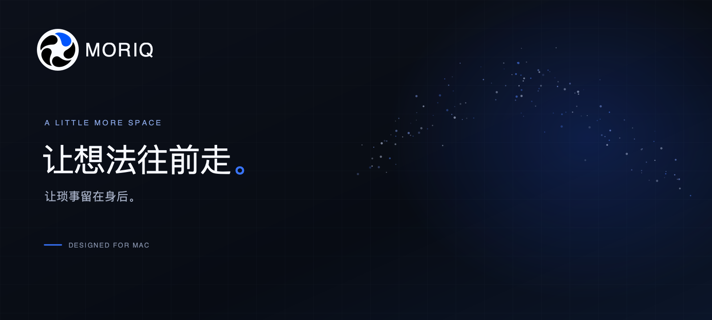

# MORIQ

**让想法往前走，让琐事留在身后。**

一组住在 Mac 里的原生小工具。 
在你需要的那一刻出现，做完，就安静退场。

`macOS` &nbsp;·&nbsp; `桌面工具` &nbsp;·&nbsp; `内测中`

 

[认识 MORIQ](#认识-moriq) &nbsp; / &nbsp; [安装与使用](#安装与使用)

---

## 认识 MORIQ

有些打断很小：换个文件格式、找回刚才复制的一段话、顺手看一眼下场会议，或者在屏幕顶端瞥一眼机器此刻的状态。小到不值得打开一个新应用，却足够让思路停下来。

MORIQ 把这些日常操作放回手边。拖一下、按一个快捷键，或者把鼠标轻轻推向屏幕顶端，一切就绪；手离开，界面便退回桌面背后。

### 屏幕顶端，留给手边的事

**液态玻璃灵动岛** · 平时收敛成屏幕顶边的一枚轻巧胶囊，鼠标靠上即刻展开。收起态的胶囊外壳与显示槽位都可按喜好自由拼装——算力、网速、电量、AI 余量、下场日程或番茄倒计时，一眼即得。 
**就地自由 DIY 画布** · 点击右上角 `DIY`，组件样式库直接在灵动岛正下方滑出，对着上方的真实画布实时拖拽排序、切换 `4×2 / 4×3 / 4×4` 格数或挑选不同尺寸与样式卡片，改完即收起，不必跳转窗口。 
**日程、待办与便签并存** · 支持日、周、月视图排期与会议链接一键入会，可按需连接 macOS 本地日历、Google 日历、提醒事项与备忘录，也可完全留在岛内独立使用；新接入外部数据源时始终与岛内记录并列合并，绝不覆盖已有内容。 
**深度算力、网络与电源防休眠** · 内核直读本机芯片、性能核与能效核负载、高占用应用、实时上下行速率与会话累计流量，以及适配器输入、电池与整机三路功耗；内置保持屏幕常亮与合盖防休眠定时控制（30 分钟至不限时长，到期自动释放），同时顺手集成亮度、音量、应用混音、隐藏 Dock、锁键盘清洁与窗口磁吸分屏。 
**AI 配额与开发工具** · 只读同步常用 AI 平台配额状态并支持低余量预警，顺手查看和释放本机监听的开发端口；专注计时与音乐播放同样随手可控。

### 文件，不必绕路

**光学转换圆盘** · 拖起文件，按住触发键，圆角扇区绕指尖展开。滑向目标格式，松手即开始转换。 
**文件暂存架** · 把待用的文件暂放在屏幕边缘，跨窗口、跨应用随时取出。 
**剪贴板** · 找回复制历史，把常用片段收藏起来，本机加密保存，一点即可复用。

### 看见的，随手处理

**超级截图** · 跨应用框选、复制、识别文字、翻译、标注与贴图，让截图从画面变成可以继续使用的信息。 
**屏幕便签** · 念头写下即存，留在灵动岛里，也能一键钉在桌面上。 
**实时字幕** · 为电脑系统声音生成字幕，支持原文与双语显示，同语种自动只展示正文，历史记录可随时回读与复制。识别和翻译效果会受到语言资源、设备性能和音频环境影响。

### 需要思考时，有个助手

**底中 AI 胶囊** · 在屏幕下方中央轻巧唤出，向上平滑展开，围绕当前屏幕继续提问；支持内联回看对话历史、一键将回答存为岛内便签，双击顶栏即可回到居中位置。在线功能需要网络和可用的 MORIQ 服务。

## 安装与使用

MORIQ 面向 **macOS 15 或更高版本**，请选择与你的 Mac 芯片对应的内测版：

[下载 Apple 芯片 Mac 版](https://github.com/Shaozrrr/MORIQ/releases/download/v0.1.0-macos-beta35/MORIQ-Apple.dmg) · [下载 Intel 芯片 Mac 版](https://github.com/Shaozrrr/MORIQ/releases/download/v0.1.0-macos-beta35/MORIQ-Intel.dmg)

打开下载的 DMG，将 MORIQ 拖入「应用程序」文件夹，再从应用程序中启动。

首次使用时，应用会引导你了解所需权限。截图、系统音频字幕、日历与提醒事项同步及部分桌面交互分别需要相应的 macOS 权限；具体说明会在应用内提供。

快捷键可在应用设置中调整，浅色玻璃与深色曜石外观也可一键切换。

---

**MORIQ** 
让常用的桌面操作更顺手。

